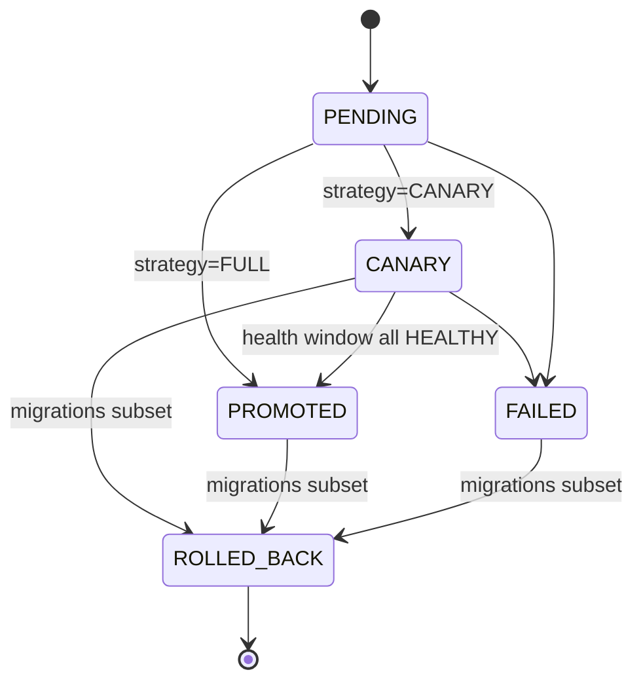

# CLIP-095 — CI/CD canary and rollback (M23)

## Goal

Make the deployment pipeline from `11_CI_CD_DEPLOYMENT.md` an auditable,
first-class record: immutable deployments, a gated canary rollout, a
one-command rollback that respects the expand/contract discipline, and the
§Release evidence bundle the spec requires.

## Deliverables

| Path | Purpose |
| --- | --- |
| `services/api/clipos_api/deployments.py` | Typed contracts, pure predicates, store, routes |
| `services/api/migrations/versions/0069_deployments.py` | `deployments`, `release_evidence` (CREATE-only) |
| `services/api/tests/test_deployments.py` | 31 tests |

## Pure predicates

- `deployment_transition_allowed(current, target)` — the rollout state
  machine: `PENDING -> CANARY -> PROMOTED`, with `FAILED` from
  PENDING/CANARY and `ROLLED_BACK` from CANARY/PROMOTED/FAILED.
  `ROLLED_BACK` is terminal; same-state is a no-op.
- `health_window_passed(observations)` — promotion gate. Requires a
  **non-empty** window in which every observation is HEALTHY, so a canary
  is promoted on evidence, never on silence.
- `rollback_conflicts(current_migrations, target_migrations)` — returns the
  migrations the rollback target lacks. Non-empty means the rollback is
  refused with a 409 (spec §Rollback: "application rollback must tolerate
  forward-compatible schema"; "destructive migrations are delayed").

## Rollout lifecycle

## Release evidence

`release_evidence` rows are append-only and idempotent per
(org_id, deployment_id), recording exactly the fields §Release evidence
lists: commit SHA, image digest, migrations, config version, agent
versions, policy versions, CI run refs, security scan summary, deploy and
rollback timestamps, rollback target, and operator approvals.
`rolled_back_at` is stamped automatically when the deployment is already
ROLLED_BACK at evidence time.

## Design notes

- **Immutable identity.** A deployment is its (commit SHA, image digest)
  pair. Re-registering the same id with a different SHA or digest is a
  409, not an update — images are immutable and tagged by commit SHA.
- **Parent linkage is validated, not required.** A deployment may name a
  `parent_deployment_id`, which must exist in the same org.
- **Backup restore is deliberately absent.** The spec is explicit that
  restore is disaster recovery, not ordinary rollback, so this module
  models only image re-pin.
- **References only, never secrets.** Reason/actor/approval fields are
  bounded reference strings; the security scan summary is text.

## Routes (CLIP-033 pattern)

POST/GET `/deployments`, GET `/deployments/{deployment_id}`, POST
`/deployments/{deployment_id}/canary`, `/promote`, `/fail`, `/rollback`,
POST/GET `/deployments/{deployment_id}/evidence`. No LLM, no network.

## Verification

- 31 new tests; 1628 passed CI-env (93.86% cov), 1 skipped.
- ruff format + check clean; mypy clean (106 source files).
- Migration 0069 applied on Postgres (0068 -> 0069); table list updated.
- OpenAPI: 243 paths, 7 new deployment routes.
- secret_scan clean; architecture_guard 6/6; deploy_topology_check PASS;
  state_audit 100/100.
