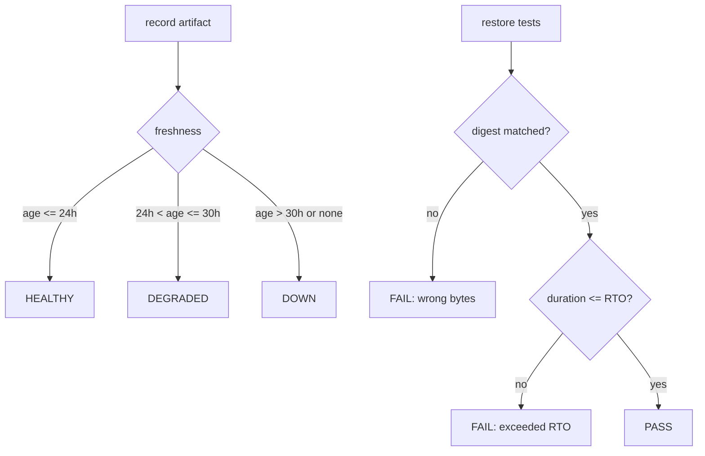

# CLIP-096 — Encrypted backup/restore verification (M23)

## Goal

Close the gap CLIP-013 left open. That ticket shipped the backup manifest
primitives and stated explicitly that encryption and restore testing stayed
"on the roadmap"; the operations runbook's backup baseline requires a
**daily encrypted full backup** and a **weekly automated restore test in an
isolated environment**. This ticket delivers both, plus the policy
predicates that decide when either has lapsed.

## Deliverables

| Path | Purpose |
| --- | --- |
| `services/api/clipos_api/backup_crypto.py` | Authenticated encryption envelope (stdlib only) |
| `services/api/clipos_api/backup_verification.py` | Artifacts, restore tests, pure policy predicates, routes |
| `services/api/migrations/versions/0070_backup_verification.py` | `backup_artifacts`, `restore_tests` |
| `services/api/tests/test_backup_verification.py` | 49 tests |

## Encryption construction

The repository has no third-party crypto dependency and is deliberately
dependency-light, so the envelope is built from stdlib primitives:

- keystream from **SHA-256 in counter mode** (SHA-256 is a PRF):
  `keystream_block_i = SHA256(key || nonce || counter_i)`, XORed with the
  plaintext;
- **encrypt-then-MAC**: HMAC-SHA256 over the canonical header *and* the
  ciphertext, so header tampering is caught as well as ciphertext tampering;
- **constant-time** tag comparison via `hmac.compare_digest`;
- purpose-separated subkeys (`SHA256(label || key)`) so the master key is
  never used directly for both encryption and MAC.

Envelope framing: `MAGIC | version | header_len | header(JSON) | ciphertext`.
The header carries an explicit `alg` and `version` field specifically so
this construction can be migrated later without breaking old backups.

**Honesty note.** This is a correct encrypt-then-MAC AEAD built from a hash
and a MAC — not a substitute for a vetted AEAD. A future revision should
switch `alg` to AES-GCM or ChaCha20-Poly1305 (libsodium/`cryptography`) and
keep version 1 readable. Nothing here claims side-channel resistance beyond
constant-time tag comparison. This is recorded in the module docstring and
in `docs/development.md` rather than left implicit.

**Key handling.** The master key is read from a named env var
(`CLIPOS_BACKUP_KEY`, 64 hex chars) or passed as bytes. It is never written
to disk, never placed in a manifest or audit event, and never logged: the
persisted artifact record holds only the opaque `key_ref` (the variable
*name*) and a truncated `key_fingerprint`.

## Restore verification

`evaluate_restore(digest_matched, duration_seconds, rto_seconds)` is pure and
keeps two failure modes distinct: a restore that reproduces the wrong bytes
is a different operational problem from one that is byte-correct but exceeds
the RTO. `check_backup_freshness` maps age-against-cadence to
HEALTHY/DEGRADED/DOWN reusing `MonitorStatus`, so backup freshness reads the
same way as every other unattended check in the runbook.
`restore_test_due` and `evaluate_drill_cadence` apply the weekly and monthly
cadences. `summarize_backup_status` folds them into one posture with an
`attention` list.

The restore-test outcome is **computed from the observations**, never taken
from the caller, so a runner cannot record a PASS by asserting one.

## Cadence logic

## Verification

- 49 new tests (encryption round-trip, ciphertext/header tampering, wrong
  key, truncation, bad magic, missing tag, unsupported alg, empty refusal,
  nonce uniqueness, key loading; all pure predicates; store idempotency and
  drift; aggregate status; routes).
- 1677 passed CI-env (93.90% cov), 1 skipped.
- ruff format + check clean; mypy clean (108 source files).
- Migration 0070 applied on Postgres (0069 -> 0070).
- OpenAPI: 247 paths, 4 new backup routes.
- secret_scan clean; architecture_guard 6/6; deploy_topology_check PASS;
  state_audit 101/101.
