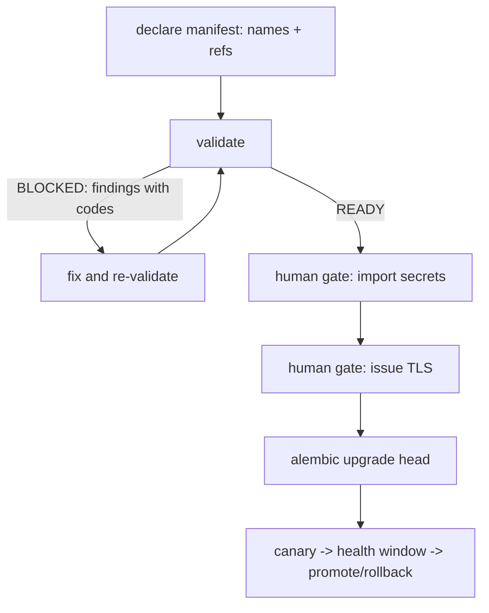

# CLIP-097 — Production bootstrap / secrets / TLS / runbook (M23 closer)

## Goal

Make production bootstrap a validated, auditable declaration rather than an
operator's checklist, while keeping real secret injection and TLS issuance
where the spec puts them: **execution-time human gates**. The ticket's own
acceptance criteria say exactly this — "bootstrap can be validated with
placeholder secret references; real secret injection is an execution-time
human gate, not a code-completion gate" — so the design never accepts or
stores a secret value.

## Deliverables

| Path | Purpose |
| --- | --- |
| `services/api/clipos_api/production_bootstrap.py` | Contracts, pure validators, store, routes |
| `services/api/migrations/versions/0071_production_bootstrap.py` | 3 tables |
| `services/api/tests/test_production_bootstrap.py` | 45 tests |
| `docs/PRODUCTION_BOOTSTRAP.md` | Operator runbook |

## Enforced rules

- **Secret references, never values.** Each required secret must be
  expressed with an accepted scheme (`${VAR}`, `vault://`, `sops://`,
  `aws-sm://`, `gcp-sm://`, `azure-kv://`). A bare literal is
  `SECRET_NOT_A_REFERENCE`; anything that *looks* like a secret is
  `SECRET_LITERAL`. Both are blocking, and the store refuses a manifest
  carrying a secret-shaped literal outright — so a value cannot reach
  persistence even by mistake.
- **TLS material.** Certificate and key must be references, must not share
  a reference, and a self-signed certificate is refused for `production`
  (`TLS_SELF_SIGNED_IN_PRODUCTION`). Issuance stays a human gate.
- **Rotation for every connector.** `rotation_gaps` is pure; a validation
  asked to check a connector list reports each unregistered connector as a
  blocking `ROTATION_MISSING` finding.

## Human-gate honesty

`evaluate_bootstrap_readiness` returns `human_gates_remaining` alongside the
verdict. A `READY` verdict therefore never reads as "safe to deploy
unaided" — it carries the two gates that still apply in production
(secret import, TLS issuance). The runbook states this in its opening
paragraph as well.

## Bootstrap flow

## Design notes

- **`/production/readiness` is a POST, not a GET.** A readiness evaluation
  over a full declaration (including a `secret_refs` mapping) has no
  sensible query-string encoding; FastAPI rejects a `dict` as a query
  parameter. Making it a body-carrying POST is both correct and clearer.
- **Drift detection covers the whole identity.** `domain_ref` and
  `tls_self_signed` are part of a manifest's identity, so they are included
  in the idempotency conflict check — a drift in either is a 409, not a
  silent overwrite.
- **Cadence is derived, not supplied.** `cadence_days` is computed from the
  `RotationCadence` enum so a caller cannot register a 30-day cadence with
  a 365-day number.
## Verification

- 45 new tests (every reference scheme, missing/literal/secret-shaped
  secrets, TLS reference/reuse/self-signed rules, rotation gaps, readiness
  verdicts and gates, store idempotency and drift, persistence refusal,
  routes, JSON serializability).
- 1726 passed CI-env (93.94% cov), 1 skipped.
- ruff format + check clean; mypy clean (109 files; 2 pre-existing baseline
  unused-ignore errors only).
- Migration 0071 applied on Postgres (0070 -> 0071).
- OpenAPI: 252 paths, 5 new production routes.
- secret_scan clean; architecture_guard 6/6; deploy_topology_check PASS;
  state_audit 102/102.
