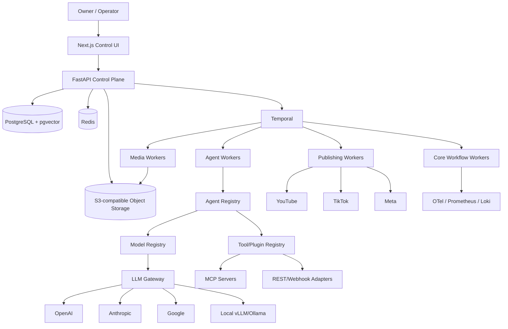

# ClipOS System Architecture

## 1. Architectural style
Start as a **modular monolith plus dedicated worker processes**. Domain boundaries are explicit, but avoid premature microservices. Media rendering, durable workflow workers, and optionally local inference are separate processes/containers because they have different resource profiles.

## 2. Core stack
- Web: Next.js, React, TypeScript.
- API/application: FastAPI, Python, Pydantic, SQLAlchemy, Alembic.
- DB: PostgreSQL with pgvector extension.
- Cache/rate-limits: Redis.
- Durable orchestration: self-hosted Temporal.
- Object storage: S3-compatible (MinIO locally; production can use MinIO, Cloudflare R2, S3, or compatible service).
- Media: FFmpeg/ffprobe; optional GPU acceleration exposed as capability, never assumed.
- Agent runtime: Python; OpenAI Agents SDK may be used for OpenAI-backed specialists, but registry/runtime abstractions must not make the application provider-locked.
- LLM gateway: internal interface with optional LiteLLM deployment; provider adapters behind logical model aliases.
- Events: transactional outbox initially; NATS JetStream only when event throughput/decoupling justifies it.
- Observability: OpenTelemetry, Prometheus, Grafana, Loki; optional Sentry.
- Reverse proxy/TLS: Caddy or Traefik.
- Packaging: Docker Compose first; k3s/Kubernetes only after measured need.

## 3. Logical architecture

## 4. Bounded modules
1. identity
2. organizations
3. governance
4. brands
5. signals
6. rights
7. sources
8. research
9. content_planning
10. media
11. publishing
12. analytics
13. monetization
14. finance
15. experiments
16. agents
17. models
18. tools_plugins
19. workflows
20. operations
21. notifications

Cross-module changes occur via application services and typed contracts; never import another module's persistence internals directly.

## 5. Deployment topology
### Initial single-server production
Containers:
- `web`
- `api`
- `temporal`
- `temporal-ui`
- `postgres`
- `redis`
- `object-storage` if not external
- `worker-core`
- `worker-agent`
- `worker-media`
- `worker-publisher`
- `llm-gateway`
- `otel-collector`
- `prometheus`
- `grafana`
- `loki`
- reverse proxy

### Scale-out path
- move PostgreSQL to separate host/managed DB;
- add media worker servers;
- add GPU worker pool;
- use external object storage;
- add NATS if event fanout becomes material;
- move Temporal persistence/cluster separately;
- k3s only after Docker Compose operational limits are proven.

## 6. Data flow principles
- PostgreSQL stores metadata/state, not large media blobs.
- Object storage stores video/audio/image/transcript artifacts and evidence documents.
- Signed URLs are short lived.
- Secrets are referenced by opaque `secret_ref`, never copied into application tables.
- Provider webhooks are normalized to internal events.
- Every external write records request fingerprint, idempotency key, provider response identifier, and audit event.

## 7. Provider abstraction
Core domains use interfaces such as:
- `LLMProvider`
- `EmbeddingProvider`
- `TranscriptionProvider`
- `TextToSpeechProvider`
- `ImageGenerationProvider`
- `VideoGenerationProvider`
- `SearchProvider`
- `PublishingProvider`
- `AnalyticsProvider`
- `AffiliateProvider`
- `StorageProvider`

Provider-specific DTOs remain inside adapters.

## 8. Failure model
Transient errors -> Temporal activity retry with bounded exponential backoff.
Rate limit -> provider-aware retry-after plus token bucket.
Provider outage -> circuit breaker -> configured fallback if action semantics allow.
Permanent policy/auth errors -> stop retry -> incident + approval/action queue.
Duplicate execution -> idempotency record returns existing result.
Media corruption -> quarantine asset; never publish.
Rights uncertainty -> quarantine content; never publish.

## 9. Consistency
- database mutations and emitted domain events use transactional outbox;
- external writes use idempotency records;
- workflow state is durable in Temporal;
- analytics ingestion is eventually consistent;
- finance ledger is append-only and reconciled.

## 10. Multi-tenancy stance
Even if initially single-owner, all top-level business records carry `organization_id` so the system can later support multiple operating entities. Tenant isolation tests are mandatory for every tenant-owned domain. Cross-organization sharing is not part of the initial product.
