# ClipOS deployment topologies

Three Compose topologies ship with the repository:

| File | Purpose | Credentials |
| --- | --- | --- |
| `docker-compose.dev.yml` (repo root) | Local development | non-production (`clipos_dev`) |
| `deploy/compose.staging.yml` | Staging; mirrors production shape | non-production, staging-scoped |
| `deploy/compose.production.yml` | Hardened production | production, injected at deploy time |

Staging mirrors production service-for-service. The resource limits differ
(staging runs on a reduced budget); everything else — networks, health
checks, restart policies, secret references — is identical, so a change
that passes in staging is expected to behave the same in production.

## Hardening invariants

`scripts/deploy_topology_check.py` validates both hardened topologies
against eight invariants, defined in `clipos_api/deployment_topology`:

| ID | Invariant |
| --- | --- |
| H1 | Internal services (postgres, redis, minio, temporal) publish no host port |
| H2 | No development credential marker (`clipos_dev`, `*_local_only`) appears |
| H3 | Every service declares a non-`"no"` restart policy |
| H4 | Every long-running service declares a healthcheck |
| H5 | No service is privileged and no `docker.sock` is mounted |
| H6 | Every service declares cpu and memory limits |
| H7 | No secret-like literal is present in the file |
| H8 | Reference-only keys (`DATABASE_URL`, `STORAGE_SECRET_KEY`, …) use `${VAR}` injection |

The check runs in CI (`validate` job) and fails the build on any FAIL.

```bash
python3 scripts/deploy_topology_check.py            # human-readable
python3 scripts/deploy_topology_check.py --json out.json
python3 scripts/deploy_topology_check.py --strict    # warnings fail too
```

## Network topology

Two bridges keep the internal data plane off the host:

```mermaid
graph TD
    Internet --> edge[edge: caddy, 80/443]
    edge --> web[web: Next.js 3000]
    edge --> api[api: 8000]
    web -.edge net.- edge
    api --> internal[[clipos_internal &#40;internal: true&#41;]]
    worker[worker] --> internal
    internal --> postgres
    internal --> redis
    internal --> minio
    internal --> temporal
```



Only `edge` (and, in staging, the reduced staging edge) publishes host
ports. `postgres`, `redis`, `minio` and `temporal` live exclusively on the
`clipos_internal` network, declared `internal: true`, so they are
unreachable from outside the host.

## Bringing up a topology

```bash
# staging
cp deploy/env.staging.example deploy/.env.staging   # fill values
docker compose -f deploy/compose.staging.yml --env-file deploy/.env.staging up -d

# production
cp deploy/env.production.example deploy/.env.production   # fill values
docker compose -f deploy/compose.production.yml --env-file deploy/.env.production up -d
```

Images are referenced by immutable digest (`CLIPOS_API_IMAGE`,
`CLIPOS_WEB_IMAGE`), tagged by commit SHA. Application rollback is a
re-pin of those two variables — see `11_CI_CD_DEPLOYMENT.md`.

## Secrets

`deploy/env.production.example` and `deploy/env.staging.example` contain
variable **names only** — they are committed (the names are not secret);
the filled `.env.*` files they are copied to are not. Real values are
injected on the host from the server secret manager. `.env*` files are
blocked from commit by `scripts/secret_scan.sh`, and invariant H7 fails the
topology check if a secret-like literal is ever written into a Compose file.

Production secret import and TLS certificate issuance are human gates; this
topology only declares the shape they fill in.
