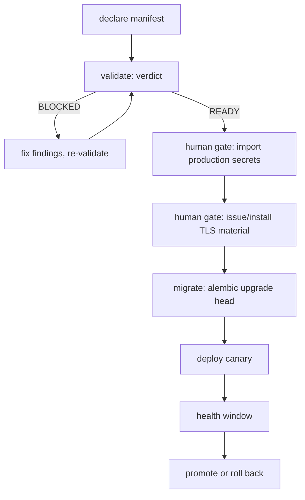

# Production bootstrap, secrets, TLS and rotation

This runbook covers taking ClipOS from a built artifact to a running
production deployment. It is the operator-facing companion to
`clipos_api/production_bootstrap.py`, which validates a bootstrap
*declaration* and reports readiness.

**Real secret injection and TLS issuance are mandatory human gates**
(`13_HUMAN_GATES_AND_SECRETS.md`, gates 1 and the TLS bootstrap in your
infrastructure provisioning). The code-complete path in this repository
validates the *shape* of a bootstrap with placeholder references; it never
handles a secret value. A `READY` verdict from the validator means "the
declaration is complete and well-formed", **not** "safe to deploy unaided".

## 1. Filesystem layout

`16_VPS_GITHUB_RUNBOOK.md` asks for repo, worktrees and runtime state to be
separated:

```text
/srv/clipos/
  clipOS/        # canonical checkout used for integration and state
  worktrees/     # one isolated worktree per active ticket
  runtime/       # non-repo runtime state
  logs/
  cache/
  backups/
  staging/
  production/
```

## 2. Secret inventory

Every production bootstrap must declare these names. Values are never
written down here or anywhere in the repository — only the names and the
*scheme* used to inject them.

| Name | Purpose |
| --- | --- |
| `DATABASE_URL` | Postgres connection |
| `POSTGRES_PASSWORD` | Postgres role password |
| `CACHE_REDIS_URL` | Redis connection (includes the password) |
| `STORAGE_ACCESS_KEY` | Object-storage access key |
| `STORAGE_SECRET_KEY` | Object-storage secret key |
| `MINIO_ROOT_PASSWORD` | Object-storage root password |

Accepted reference schemes: `${VAR}`, `vault://`, `sops://`, `aws-sm://`,
`gcp-sm://`, `azure-kv://`. A bare literal — and in particular anything
that *looks* like a secret — is rejected with a blocking finding, so a
value cannot reach persistence even by accident.

## 3. TLS material

A production bootstrap declares references to a certificate and a private
key. The validator enforces three things: both are references (never inline
PEM), the certificate and key do **not** share a reference, and a
self-signed certificate is refused for `production` (it is permitted in
`staging`). Certificate *issuance* is a human gate; this repository only
records where the material will come from.

## 4. Rotation

`13_HUMAN_GATES_AND_SECRETS.md` requires a rotation procedure for every
connector. Register one per connector with a cadence
(`EVERY_30_DAYS` / `EVERY_90_DAYS` / `EVERY_180_DAYS` / `ANNUALLY`), a
procedure reference, and an owner. A bootstrap validation that is asked to
check a connector list reports any connector with no registered rotation as
a blocking `ROTATION_MISSING` finding.

## 5. Bootstrap validation

Declare the manifest, then validate it:

```bash
# Declare (names and references only — no values)
curl -sS -X POST http://127.0.0.1:8111/production/bootstrap \
  -H 'Content-Type: application/json' \
  -d '{
        "manifest_id": "boot-prod-1",
        "org_id": "clipos",
        "environment": "production",
        "secret_refs": {
          "DATABASE_URL": "${DATABASE_URL}",
          "POSTGRES_PASSWORD": "vault://clipos/postgres",
          "CACHE_REDIS_URL": "${CACHE_REDIS_URL}",
          "STORAGE_ACCESS_KEY": "vault://clipos/storage/access",
          "STORAGE_SECRET_KEY": "vault://clipos/storage/secret",
          "MINIO_ROOT_PASSWORD": "vault://clipos/minio"
        },
        "tls_cert_ref": "vault://clipos/tls/fullchain",
        "tls_key_ref": "vault://clipos/tls/privkey",
        "tls_self_signed": false,
        "domain_ref": "clipos.example.com"
      }'

# Validate (records the verdict; repeat per connector list as needed)
curl -sS -X POST http://127.0.0.1:8111/production/bootstrap/validations \
  -H 'Content-Type: application/json' \
  -d '{"validation_id": "val-1", "org_id": "clipos", "manifest_id": "boot-prod-1"}'
```

Read the verdict from the response or `GET /production/readiness`. Findings
carry a `code` (`SECRET_MISSING`, `SECRET_LITERAL`,
`SECRET_NOT_A_REFERENCE`, `TLS_CERT_NOT_REFERENCED`,
`TLS_KEY_NOT_REFERENCED`, `TLS_MATERIAL_REUSED`,
`TLS_SELF_SIGNED_IN_PRODUCTION`, `ROTATION_MISSING`), a `severity`, and the
`subject_ref` to fix.

## 6. Bring-up order



Deployment mechanics (immutable images, canary, rollback) are in
`11_CI_CD_DEPLOYMENT.md` and `deploy/README.md`. Rollback is an image
re-pin; restore from backup is disaster recovery and is covered by
`docs/development.md` (backup and restore verification).

## 7. What the automated checks do not do

- They do not import, generate, or store a secret value.
- They do not issue or install a certificate.
- They do not perform the deployment.

Those are the human gates. What they *do* guarantee is that when an
operator reaches the import step, the declaration has no missing secret,
no literalled value, no TLS misconfiguration, and no connector lacking a
rotation procedure.
